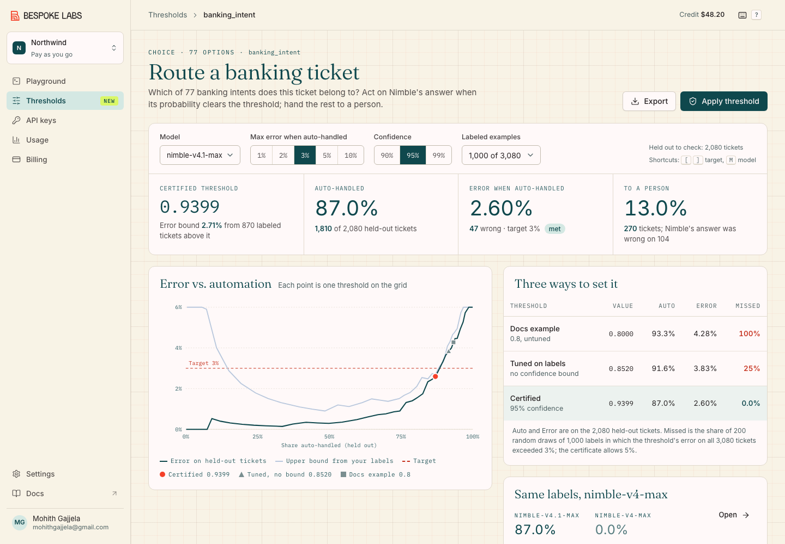

# Certified thresholds for Nimble

**Live demo:** https://mohith26.github.io/bespoke-nimble-thresholds/

Nimble returns a probability for every answer, and its docs and agent skill say the same thing in several places: choose thresholds from labeled examples, not by guessing, and re-check them when you change models. This is a concept for a **Thresholds** page in the Nimble console that does that step for you, with a guarantee. You pick the error rate you can live with on the requests your code handles on its own (say 3%) and a confidence level (95%). From your labeled examples it returns the lowest probability threshold for which a finite-sample test shows the error stays under that target, how much traffic that automates, how many labels you would need to automate more, and what happens when you move the question to another model. Everything runs on Bespoke Labs' own published per-request Nimble outputs joined to human labels.



## Headline result

On BANKING77 (3,080 real banking support messages, 77 intents, human labels), with 1,000 labeled tickets, a 3% target and 95% confidence:

| | Threshold | Auto-handled (held out) | Error when auto-handled (held out) | Draws where the threshold's true error > 3% |
|---|---|---|---|---|
| Docs example threshold (0.8) | 0.8 | 93.3% | 4.28% | 100% |
| Tuned on the labels, no bound | 0.8520 | 91.6% | 3.83% | 25% |
| **Certified (this feature)** | **0.9399** | **87.0%** | **2.60%** | **0%** |

Averaged over 200 random draws of 1,000 labels, the certified threshold auto-handles **82.0%** of the remaining tickets, and in none of the 200 draws did its error on all 3,080 tickets exceed 3% (the guarantee allows 5% of draws). Tuning the threshold on the same labels without a bound exceeded 3% in 25% of draws. The same 1,000 labels certify nothing at 3% on nimble-v4-max: the upgrade to nimble-v4.1-max is what makes automation possible here, and the threshold has to be re-certified to see it. Source: `results/results.json` (`headline`).

## How it works

1. **Data.** `scripts/extract.py` joins Bespoke Labs' Decision Index 0.3 runs of nimble-v4-max and nimble-v4.1-max ([huggingface.co/datasets/bespokelabs/nimble-v4-max-decision-index](https://huggingface.co/datasets/bespokelabs/nimble-v4-max-decision-index), per-request probabilities) to the exact raw files the Decision Index kit hashes (BANKING77 test, CLINC150 test + out-of-scope test). It checks every SHA-256 and refuses to write unless the joined accuracy equals the published `field_accuracy` for each model and benchmark. It does: 93.18% / 80.65% on BANKING77, 95.38% / 91.35% on CLINC150+OOS.
2. **Score.** The probability of Nimble's top choice. Policy: act when the score is at least the threshold `t`, otherwise send to a person.
3. **Certify** (`src/thresholds.js`, Learn then Test, Angelopoulos et al. 2021). For each threshold on a pre-registered grid (sigmoid of z = 11.5 down to -2.0, 55 points) the null hypothesis is "error among requests at or above `t` is more than eps". Given n labeled requests above `t` with k mistakes, the exact binomial tail `P(Bin(n, eps) <= k)` is a valid p-value. Thresholds are tested with fixed-sequence testing from four pre-registered starting points, each at level delta/4, which controls the family-wise error at delta. The lowest rejected threshold is returned, with its exact one-sided Clopper-Pearson bound.
4. **Check.** Everything not used as a label is held out, and the page shows the held-out automation and error. `scripts/precompute.mjs` repeats the whole procedure on 200 random label draws for every setting and treats the full benchmark as the population: a draw "misses" when the chosen threshold's error on all requests exceeds the target, which is exactly what the certificate bounds. The same simulation at 250 to 2,000 labels drives the label-budget chart.
5. **Act.** Apply stores the certificate (model, target, confidence, label count, threshold, bound) in localStorage and marks the question Certified; a certificate made on another model shows as "Re-certify: model changed". Export gives the certificate as JSON and the held-out decisions as CSV. The code panel prints the threshold in the shape of the Nimble agent skill's example, with the model pinned.

## Results

At 95% confidence with 1,000 labels (live label draw; averages over 200 draws in the last three columns):

| Question | Model | Accuracy | Target | Certified threshold | Auto / error (held out) | Mean auto (200 draws) | Certified missed | Tuned, no bound, missed | 0.8 missed |
|---|---|---|---|---|---|---|---|---|---|
| banking_intent | nimble-v4.1-max | 93.2% | 3% | 0.9399 | 87.0% / 2.60% | 82.0% | 0.0% | 25.0% | 100% |
| banking_intent | nimble-v4.1-max | 93.2% | 5% | 0.7311 | 94.6% / 4.47% | 90.9% | 0.0% | 23.5% | 0% |
| banking_intent | nimble-v4-max | 80.6% | 3% | none | 0.0% / - | 0.7% | 0.0% | 42.0% | 100% |
| banking_intent | nimble-v4-max | 80.6% | 5% | 0.9627 | 46.0% / 3.24% | 23.0% | 0.0% | 30.0% | 100% |
| assistant_intent | nimble-v4.1-max | 95.4% | 3% | 0.9890 | 89.6% / 1.81% | 80.8% | 0.0% | 53.0% | 100% |
| assistant_intent | nimble-v4.1-max | 95.4% | 5% | 0.7311 | 97.9% / 3.72% | 97.0% | 0.0% | 0.0% | 0% |
| assistant_intent | nimble-v4-max | 91.3% | 3% | none | 0.0% / - | 36.8% | 0.5% | 46.0% | 100% |
| assistant_intent | nimble-v4-max | 91.3% | 5% | 0.8520 | 77.7% / 3.09% | 77.7% | 0.0% | 41.0% | 0% |

"Missed" is the share of 200 label draws in which the threshold's error on the whole benchmark exceeded the target. Across all 300 settings in `results/results.json` (2 questions x 2 models x 5 targets x 3 confidence levels x 5 label counts), the certified threshold's miss rate never exceeded delta (the largest miss rate in any setting was 1.5% of draws, against an allowed 5% or 10%). Tuning on the same labels without a bound missed a 2-5% target in a median of 41% of draws (quartiles 27% and 52%). The held-out error itself is noisier: with only 1,080 held-out tickets at 2,000 labels it can land above the target even when the true error is below it, so the page reports both.

## Run it

```sh
node --test test/*.test.js          # 14 tests: binomial math, LTT logic, property tests, data join, headline numbers
node scripts/precompute.mjs         # regenerates results/results.json (~45 s)
python3 -m http.server              # then open http://localhost:8000
```

Rebuild the data from the public sources (about 80 MB of downloads):

```sh
mkdir -p cache/banking77 cache/clinc150 cache/nimble-v4-max cache/nimble-v4.1-max
B=https://huggingface.co/datasets/bespokelabs/nimble-v4-max-decision-index/resolve/main/runs
for m in nimble-v4-max nimble-v4.1-max; do for f in results.jsonl.gz benchmark-summary.json; do curl -L $B/$m/$f -o cache/$m/$f; done; done
curl -L https://raw.githubusercontent.com/PolyAI-LDN/task-specific-datasets/master/banking_data/test.csv -o cache/banking77/test.csv
curl -L https://raw.githubusercontent.com/PolyAI-LDN/task-specific-datasets/master/banking_data/categories.json -o cache/banking77/categories.json
curl -L https://raw.githubusercontent.com/clinc/oos-eval/master/data/data_full.json -o cache/clinc150/data_full.json
python3 scripts/extract.py cache
```

No build step: the page is static HTML, CSS and ES modules, with Lucide icons and Google Fonts from CDNs.

## Honest limitations

- **The labels stand in for a customer's.** BANKING77 and CLINC150 are public benchmarks, not Nimble customer traffic, and the prompts are the Decision Index's wording. Some BANKING77 reference labels are debatable (the examples page shows several "mistakes" where Nimble's answer is defensible), so the measured error is error against these labels, not truth.
- **The guarantee assumes future requests look like the labeled ones** (exchangeable). In the simulation, labels are drawn without replacement from a finite benchmark, which makes the binomial test slightly conservative. It says nothing under drift; the page's answer to model drift is to re-certify, and topic drift would need a monitor on top.
- **It controls error among auto-handled requests on average over requests, not per intent.** The "where the mistakes are" table shows that mistakes concentrate in a few intents (e.g. pending transfer). Per-intent guarantees need more labels per intent than these sets have.
- **The grid and the four starting points are design choices.** They are fixed before seeing labels, as the method requires, but a different grid gives slightly different thresholds. Single-start fixed-sequence testing from the strictest threshold certified almost nothing on this data (too few labels above 0.99999), which is why the multi-start variant is used.
- **Costs are not modeled.** A natural next step is choosing the target from the cost of a mistake versus a person's review time.
- **The console chrome is reconstructed.** The logged-in Nimble console is not public; the shell uses the console's production stylesheet tokens, its real route list (Playground, API keys, Usage, Billing, Settings), and the live login and landing pages as references. The organization, user and credit shown are placeholders.
- **Fonts:** the console's GT Alpina and mdIo are licensed and not loadable from another origin; the demo uses Fraunces and IBM Plex Mono (mdIo's declared fallback).

## Prior art and what is new

- Learn then Test (Angelopoulos, Bates, Candes, Jordan, Lei, 2021) and selective classification with guaranteed risk (Geifman and El-Yaniv, 2017) are the statistical basis; neither is new here.
- For TypeSafe's Jev, open-source [jevcal](https://github.com/abhixhek/jevcal) and the hosted [Jev Benchmark Lab](https://jevbenchmark.app/) tune thresholds on labeled data and check them on a held-out split; both report observed numbers and say they are not a guarantee. TypeSafe's own docs describe confidence-gated routing with hand-picked thresholds.
- Nimble's docs, README and agent skill tell users to tune and re-check thresholds on their own labels; the console (Playground, API keys, Usage, Billing, Settings) has no tool for it as of Nov 11, 2026.
- New here: a finite-sample certificate for a Nimble threshold in the console, a label-budget planner from repeated draws, re-certification on model change with the same labels, and a measured comparison against the docs' example threshold and against uncorrected tuning, on Bespoke's own published outputs.

## License and data

Code: MIT. Data: Nimble probabilities from Bespoke Labs' Decision Index runs (CC BY-NC 4.0); BANKING77 (CC BY 4.0); CLINC150 (CC BY 3.0). Unofficial concept demo by Mohith Gajjela. Not affiliated with Bespoke Labs.
